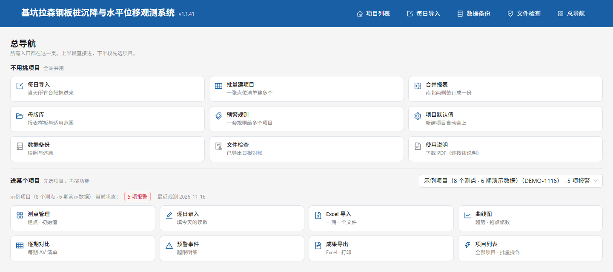
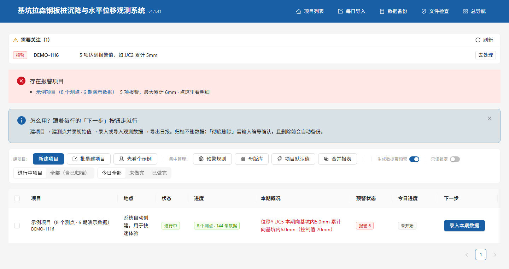
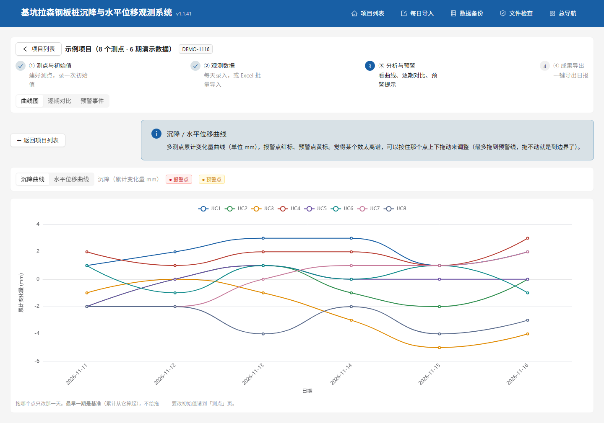
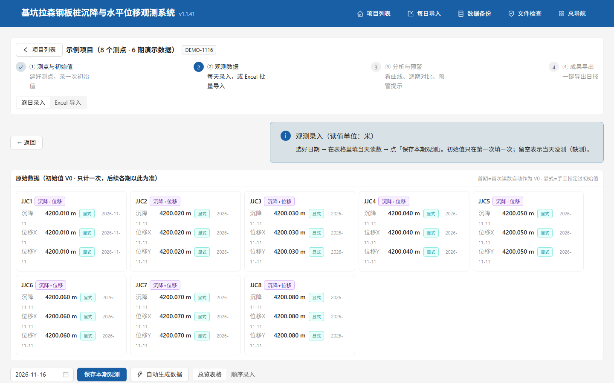
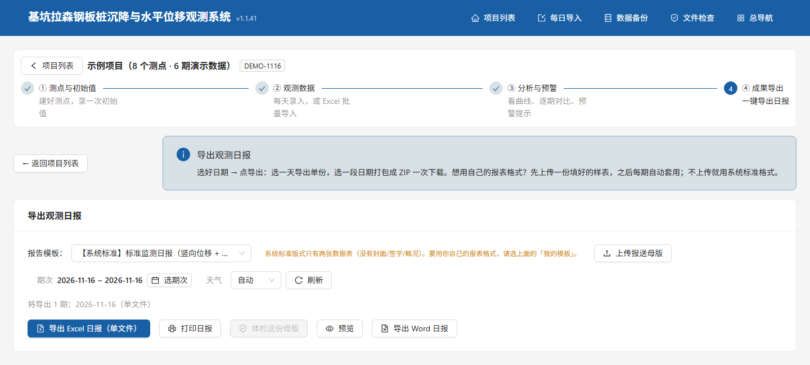

<div align="center">

# pitwatch · 基坑监测日报系统

**把每期测量台账变成能直接交出去的日报**

沉降 / 水平位移的台账导入、预警判定、母版套打、导出复核，全在一台普通办公电脑上完成。


[功能](#功能) · [截图](#界面) · [快速开始](#快速开始) · [架构](#架构) · [文档](#文档)

</div>

---

## 这是什么

给**现场技术员**用的基坑变形监测系统。围护形式以拉森钢板桩为主，监测项为**沉降**与**水平位移（X/Y）**。

日常就四步：**建测点 → 录本期读数 → 看图判级 → 导出日报**。数据落在本机 SQLite，不上云、不联网。

<table>
<tr>
<td width="50%"></td>
<td width="50%"></td>
</tr>
<tr>
<td align="center"><sub>总导航 —— 入口不靠记，一页看完</sub></td>
<td align="center"><sub>项目列表 —— 今天做完没、下一步点哪</sub></td>
</tr>
</table>

<p align="center">

<br><sub>累计变化曲线 —— 报警点标红、预警点标黄；异常点可直接拖动改值，改完自动留痕</sub>
</p>

---

## 功能

| 模块 | 能力 | 关键约束 |
|---|---|---|
| **项目与测点** | 一项目多测点，可停用 / 归档；批量建项目、批量建测点 | **有数据的项目与测点不允许物理删除** |
| **数据录入** | 表格逐格录入、顺序录入、曲线拖点修数；一期一个 Excel 文件也能批量导 | 留空 = 缺测，不当作 0；原始记录**只增不改** |
| **台账导入** | 上传即预览，确认才落库；冲突默认跳过并如实报告 | **绝不覆盖真实数据**（仅覆盖系统生成的演示数据） |
| **跨项目导入** | 一次拖多份台账，按表内「工程名称」自动分到各项目 | 认不准就明说，并给出最像的候选，不硬猜 |
| **计算引擎** | 累计 / 本次变化 / 速率，支持缺测跨期、作废、复测 | 公式**只存在于引擎**，不散落到页面与接口 |
| **预警判定** | 累计、本次变化、速率三项各判一次，取最严一级；控制值 / 报警值两级 | 规则独立成「规则库」，一套规则可作用于多个项目 |
| **禁止回弹** | 只沉不升的观测（如盖梁支架）可开启：曲线不掉头 | 只改**成果口径**，原始读数照旧入库 |
| **日报导出** | 母版套打（保留单位自己的版式）+ 系统标准版式；Excel / Word / PDF | 导出前先做「母版体检」，说清会印出什么毛病 |
| **合并报表** | 南北两侧 / 多个基坑装订成**一份**：封面、签字页、布点图共用，数据表各占一张 | 要求各项目**同一天都有数据**，不拿旧数凑页 |
| **导出复核** | 扫一个文件夹，把已导出的日报与系统逐项比对 | 核对变化量、速率、累计与「控制值」是否一致 |
| **备份与回退** | 手动快照 / 还原；版本回退只动源码 | **回退不碰数据库、母版、台账原件** |

---

## 界面

| 逐日录入 | 成果导出 |
|---|---|
|  |  |
| 一期一屏，空格即缺测；健康状态实时提示 | 选期次（可框一段批量）、仪器、天气，一键出报 |

---

## 快速开始

### 方式一 · 一键启动（Windows，最省事）

双击仓库根目录的 **`启动系统.bat`**：同时拉起后端（8000）与前端（5173），并自动打开浏览器。
关掉那个黑窗口即全部停止。

### 方式二 · 本地手动

```bash
pip install -r requirements.txt

# 后端
python -m uvicorn backend.main:app --host 127.0.0.1 --port 8000

# 前端（另开终端）
cd frontend && npm install && npm run dev
```

打开 <http://127.0.0.1:5173>。

### 方式三 · 容器（单端口）

前端在构建期编译进镜像，运行时**一个端口 8000** 同时提供页面与 API。

```bash
docker build -t pitwatch:local .
docker run -d --name pitwatch -p 8000:8000 \
  -e MONITOR_DB_URL=sqlite:////data/database/monitor.db \
  -e MONITOR_DEMO_SEED=1 \
  -v $(pwd)/data:/data \
  pitwatch:local
```

- 数据全在 `/data`：挂持久卷即可保留，换机器只搬这个目录。
- `MONITOR_DEMO_SEED=1`：空库启动时自动建一个示例项目（8 测点 / 6 期），方便先看效果。

> ⚠️ 系统**没有登录功能**。公网部署请只放示例数据，真实工程数据留在自己电脑上。

---

## 架构

```
┌──────────────────────────────┐
│  React 18 + TS + AntD 5      │  单页应用；曲线用 ECharts
└──────────────┬───────────────┘
               │ HTTP / JSON
┌──────────────┴───────────────┐
│  FastAPI + Pydantic v2       │
│  ├── services/  业务编排      │
│  ├── calculation/  计算引擎   │  ← 公式唯一出处
│  ├── warnings/    预警引擎    │  ← 判级唯一出处
│  └── reports/    报表生成/读回 │  ← openpyxl / python-docx
└──────────────┬───────────────┘
               │ SQLAlchemy 2.x
┌──────────────┴───────────────┐
│  SQLite（WAL）                │  observation_records 只增不改
└──────────────────────────────┘
```

**几处刻意的设计**：

- **原始记录与计算结果分离**：`observation_records` 只增不改；`calculation_results` / `warning_events` 可整体重算。
- **聚合接口不逐点查库**：整项目一次取数再分组，配一层以「数据库文件版本」为判据的缓存 —— 数据一变缓存自动失效，不用在几十个写入口埋清缓存。
- **导出一份册子，不是一份项目一份**：合并报表把「数据怎么存」和「报表怎么打」分开，南北两侧各自入库，打印时装订成一份。

---

## 设计原则

这套东西是给不懂代码的人用的，所以有几条是硬规矩：

1. **原始观测记录只增不改**；计算结果与预警事件可以整体重算。
2. **公式只在一个地方**（计算 / 预警引擎），不散落在页面和接口里。
3. **导入不覆盖真实数据**，冲突默认跳过并如实报告。
4. **有数据的项目与测点不物理删除**，只能停用或归档。
5. **界面上不出现** JSON 字段名、UUID、内部模式名这类开发者术语。
6. **危险操作要防呆**：按钮该灰就灰，改不了比"记得别改"可靠。

---

## 目录结构

```
backend/                 FastAPI 服务
  api/v1/                接口
  models/                数据模型
  services/              业务逻辑（计算、预警、导入、导出复核…）
  reports/               报表生成与读回（母版套打、标准版式）
  calculation/           计算引擎（纯函数）
  warnings/              预警引擎（纯函数）
frontend/                React 前端
tests/                   pytest（76 个测试文件，含"守卫测试"）
tools/                   版本管理等小工具
build_tools/             打包发布（PyInstaller）
docs/                    使用说明书、部署文档、界面截图
Dockerfile               单端口镜像
```

---

## 版本与回退

版本号是**单一出处**（`backend/core/version.py`），界面顶栏显示当前版本。

```bash
python tools/version.py list                    # 有哪些版本
python tools/version.py show                    # 现在跑的是哪一版
python tools/version.py note "这次改了什么"      # 小改：只记说明，不动版本号
python tools/version.py save "这一版干了什么"    # 发版：跳到下一个整版并汇总说明
python tools/version.py rollback v1.1.1 --yes   # 退回某一版（只回退源码，不动数据）
```

回退前会自动 stash 当前改动并打一个 `pre-rollback-<时间>` 标签，退错了还能回来。

---

## 文档

| 文档 | 内容 |
|---|---|
| [`docs/使用说明书.pdf`](docs/使用说明书.pdf) | 逐按钮、逐字段的操作说明与注意事项（40+ 页） |
| [`docs/部署-Render.md`](docs/部署-Render.md) | 免费档公网部署（仓库带 `render.yaml`） |
| [`docs/部署-Zeabur.md`](docs/部署-Zeabur.md) | 备选平台（保留作参考） |
| [`CHANGELOG.md`](CHANGELOG.md) | 每个版本改了什么 |

---

## 数据放在哪

运行数据都在项目目录下，**不进版本库**：

```
database/     监测数据（SQLite）
templates/    母版原件
uploads/      导入的台账原件
logs/         运行日志
导出/          导出的成果
```

全部可用环境变量改到别处（`MONITOR_DB_URL`、`MONITOR_TEMPLATES_DIR` 等）。升级或回退版本不会碰这些数据。

---

## 许可

暂未指定开源许可。想用在自己的项目上，欢迎先开个 Issue 聊聊。

---

<div align="center"><sub>pitwatch v1.1.41 · 本站点截图由内置示例数据生成，不含真实工程信息</sub></div>
